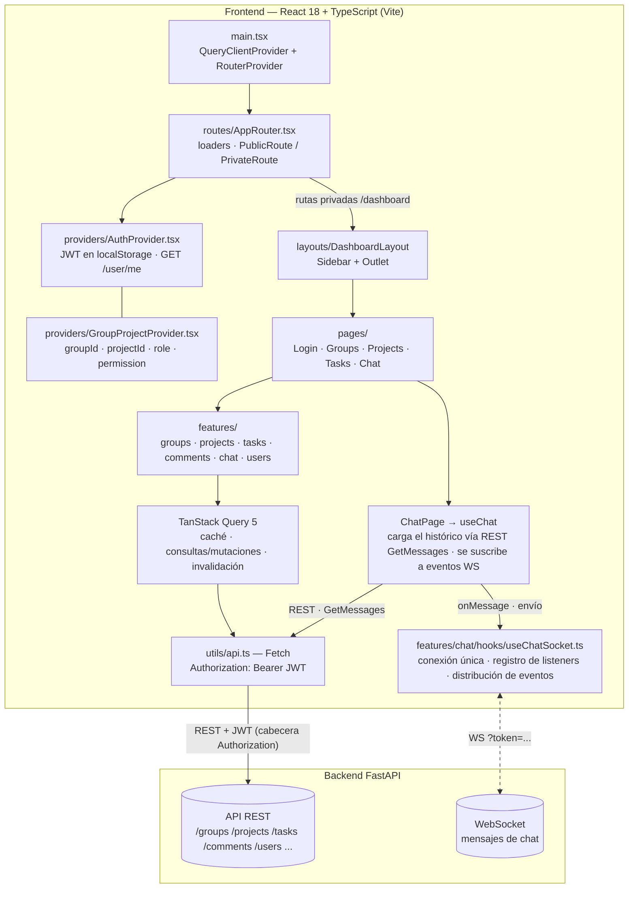
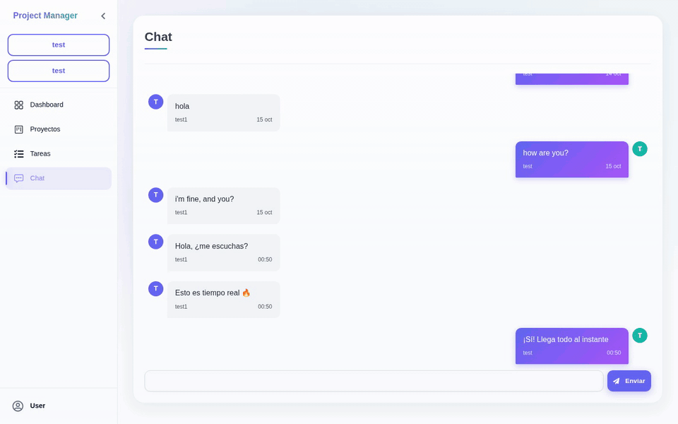

# Frontend de Gestión de Tareas

Panel de gestión colaborativa de tareas (grupos, proyectos, tablero Kanban, comentarios y chat en tiempo real) construido con **React + TypeScript** para la [API de Tareas con FastAPI](https://github.com/SrStamm/API-de-tareas-con-FastAPI).

[English](README.md) | [Español](README.es.md)

**Demo en vivo:** <https://front-task-api-vanilla.vercel.app/dashboard/tasks>

## Descripción y funcionalidades principales

Este frontend es el cliente web de la API de Tareas. Está pensado para el **trabajo colaborativo**: organiza usuarios, proyectos y tareas con comunicación en tiempo real.

- **Grupos** — creación de grupos, gestión de miembros y asignación de roles por grupo.
- **Proyectos** — proyectos dentro de grupos, con sus propios miembros y permisos.
- **Tareas Kanban** — tablero con arrastrar y soltar (`@dnd-kit`), estados, etiquetas y modal de detalle.
- **Comentarios en tareas** — comentarios en la vista de detalle de cada tarea.
- **Vista de tareas asignadas** — listado paginado y personal de tareas asignadas al usuario actual.
- **Chat en tiempo real** — mensajería por proyecto mediante WebSocket.
- **Roles y permisos** — acciones restringidas según el rol de grupo y el permiso de proyecto.
- **Tema claro / oscuro** — conmutador persistido en `localStorage`.
- **Filtros de tareas** — filtrado de tareas del proyecto y asignadas por estado y etiqueta.

## Diagrama de arquitectura

La aplicación es un SPA de Vite + React organizado en carpetas por funcionalidad (*features*). La capa de datos usa TanStack Query sobre un envoltorio común `Fetch` (`src/utils/api.ts`) que inyecta el JWT desde `localStorage`; el tiempo real fluye por un hook dedicado de WebSocket.



Piezas clave del código real:

| Capa | Ubicación | Rol |
| ---- | --------- | --- |
| Enrutamiento y guards | `src/routes/AppRouter.tsx`, `ProtectedRoute`, `PublicRoute` | Público `/login` y `/register`; privado `/dashboard/*` tras un loader de token |
| Proveedores | `src/providers/AuthProvider.tsx`, `GroupProjectProvider.tsx` | Estado de autenticación (usuario, login/logout) y contexto de grupo/proyecto seleccionado con rol/permiso |
| Cliente REST | `src/utils/api.ts` | Envoltorio único `Fetch`: cuerpo JSON, token `Bearer` y manejo de errores |
| Capa de consultas | hooks en `src/features/*` | TanStack Query: caché, mutaciones y paginación infinita de tareas asignadas |
| Tiempo real | `src/features/chat/hooks/useChatSocket.ts` | Un socket, registro de listeners con distribución; hoy el chat es el único suscriptor |
| Carpetas de funcionalidad | `src/features/{groups,projects,tasks,comments,chat,users}` | Cada feature posee su `api/`, `components/`, `hooks/` y `schemas/` (Zod) |

## Decisiones técnicas

- **TanStack Query** — centraliza el estado del servidor: consultas, mutaciones y una caché única; los componentes no gestionan a mano el estado de las peticiones; las mutaciones invalidan las consultas relacionadas.
- **Carpetas por funcionalidad** — cada dominio (grupos, proyectos, tareas, comentarios, chat, usuarios) posee su `api/`, `components/`, `hooks/` y `schemas/` (Zod); las features permanecen independientes.
- **Hook de WebSocket** — `useChatSocket` posee la conexión única y un registro de listeners; las features se suscriben mediante `onMessage` en lugar de gestionar sockets. El chat es el primer consumidor.
- **Envoltorio único `Fetch`** — `utils/api.ts` es el único punto que inyecta el JWT y normaliza los errores.

## Tecnologías

| Tecnología | Versión | Rol |
| ---------- | ------- | --- |
| React | ^18.2.0 | Librería de UI |
| TypeScript | ~5.9.3 | Sistema de tipos |
| Vite | ^7.1.7 | Servidor de desarrollo y empaquetado de producción |
| react-router-dom | ^7.9.5 | Enrutamiento del lado del cliente (data router + loaders) |
| TanStack Query | ^5.90.12 | Capa de estado de servidor (consultas, mutaciones, caché) |
| @dnd-kit (core + modifiers) | ^6.3.1 / ^9.0.0 | Arrastrar y soltar en el tablero Kanban |
| Zod | ^4.1.12 | Validación de esquemas |
| react-icons | ^5.5.0 | Conjunto de iconos |
| ESLint | ^9.36.0 | Análisis estático (configuración plana, `typescript-eslint`) |
| CSS | — | CSS personalizado plano, temas claro/oscuro |
| Backend | — | [API de Tareas con FastAPI](https://github.com/SrStamm/API-de-tareas-con-FastAPI) (REST + WebSocket + JWT) |

## Instalación y ejecución

> La aplicación vive en el directorio `front-tasks/`. El lockfile versionado es `package-lock.json`, por lo que **npm es el gestor de paquetes canónico**.

El frontend necesita una instancia de la API de Tareas en ejecución. Consulta el [README del backend](https://github.com/SrStamm/API-de-tareas-con-FastAPI#readme) para instalarla y levantarla (Docker Compose o uvicorn), y apunta VITE_URL / VITE_URL_WS hacia ella.

1. Clona el repositorio:

   ```bash
   git clone https://github.com/SrStamm/front-task-api-vanilla.git
   cd front-task-api-vanilla/front-tasks
   ```

2. Instala las dependencias:

   ```bash
   npm install
   ```

3. Configura las variables de entorno (ver siguiente sección).

4. Inicia el servidor de desarrollo:

   ```bash
   npm run dev
   ```

5. Abre el navegador en <http://localhost:5173>.

<details>
<summary>Opcional: pnpm</summary>

```bash
pnpm install
pnpm dev
```

</details>

## Variables de entorno

Crea un archivo `.env` dentro de `front-tasks/` (Vite lee las variables `VITE_*` en tiempo de desarrollo/compilación):

| Variable | Propósito | Ejemplo |
| -------- | --------- | ------- |
| `VITE_URL` | URL base de la API REST | `https://your-api.example.com` |
| `VITE_URL_WS` | URL **completa** del WebSocket, con la ruta incluida | `wss://your-api.example.com/ws` |

```bash
# front-tasks/.env
VITE_URL=https://your-api.example.com
VITE_URL_WS=wss://your-api.example.com/ws
```

`VITE_URL_WS` debe ser la URL completa del WebSocket, incluida la ruta (por ejemplo `/ws`): el cliente la analiza con `new URL(ws_url)` y añade `?token=`. Ambas URLs deben apuntar a una instancia en ejecución de la [API de Tareas con FastAPI](https://github.com/SrStamm/API-de-tareas-con-FastAPI).

## Pruebas y comandos

| Script | Comando | Propósito |
| ------ | ------- | --------- |
| `npm run dev` | `vite` | Servidor de desarrollo con HMR |
| `npm run build` | `tsc -b && vite build` | Verificación de tipos y generación del bundle de producción en `dist/` |
| `npm run lint` | `eslint .` | Análisis de todos los archivos TypeScript/TSX (configuración plana) |
| `npm run preview` | `vite preview` | Sirve localmente la compilación de producción |

> **Nota honesta:** actualmente **no hay una suite de pruebas unitarias** configurada en este proyecto. Los comandos de verificación disponibles son `npm run lint` y `npm run build`.

## Capturas de pantalla

| Captura | Vista previa |
| ------- | ------------ |
| Inicio de sesión |  |
| Panel (dashboard) |  |
| Tareas — tablero Kanban |  |
| Chat |  |
| Chat en tiempo real — intercambio en vivo |  |

## Limitaciones conocidas

Correcciones pendientes actuales, en orden de impacto:

1. **Mensajes duplicados ocasionales** en el chat y en las vistas de proyecto — los observadores de TanStack Query requieren ajustes para que las actualizaciones en tiempo real no rendericen entradas duplicadas.
2. **Reconexión de WebSocket** — el hook de socket aún no tiene una estrategia automática de reconexión con *backoff*; una conexión interrumpida requiere recargar la página.
3. **Llamadas redundantes a `/refresh`** — algunos flujos disparan el endpoint de *refresh* más de lo necesario y deberían deduplicarse.
4. **Los eventos de WebSocket más allá del chat aún no se muestran** — el backend puede emitir eventos de notificación (asignación de tareas, menciones), pero el cliente actualmente solo procesa mensajes de chat; los demás tipos de evento se ignoran.
5. **Sin suite de pruebas automatizadas** — la verificación se apoya actualmente en `npm run lint` y `npm run build`.

## Demo en vivo

- **URL:** <https://front-task-api-vanilla.vercel.app/dashboard/tasks>
- **Usuario:** `test`
- **Contraseña:** `test`

## Autor

**Mirko Alexander Stamm** — desarrollador Backend & Full-Stack.

## Licencia

Este proyecto se distribuye bajo la licencia MIT.
