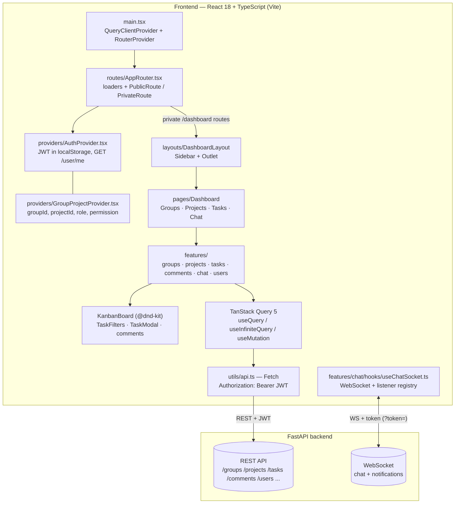
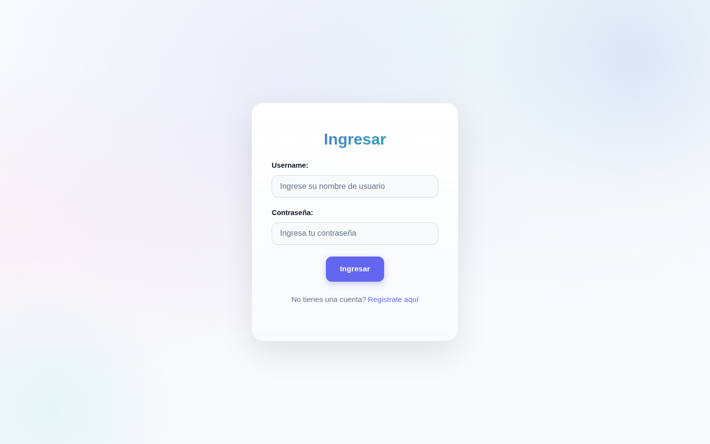
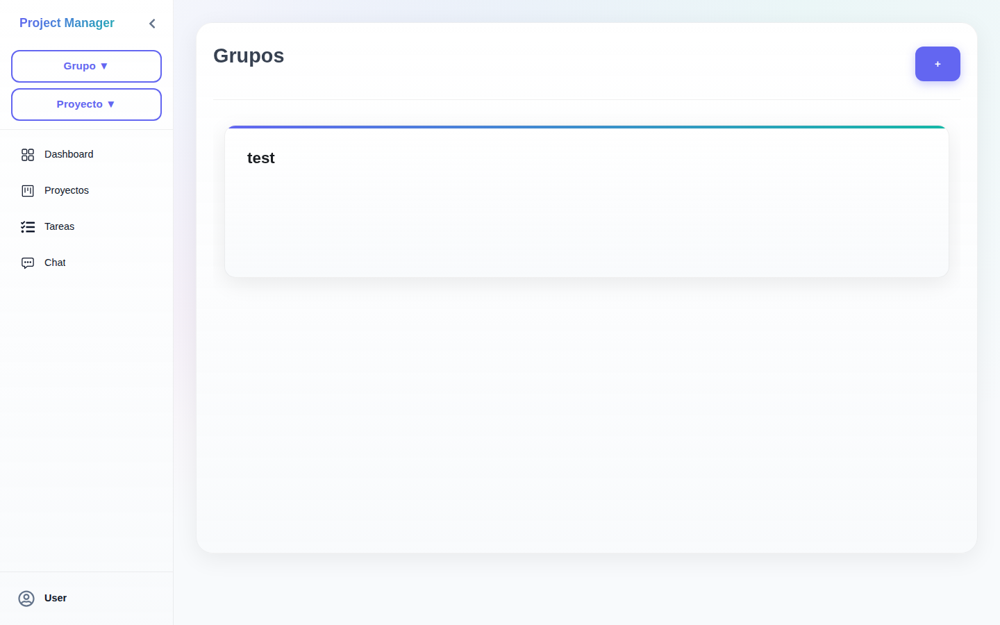
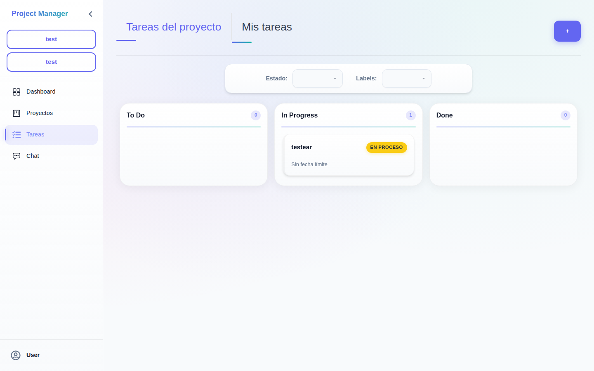
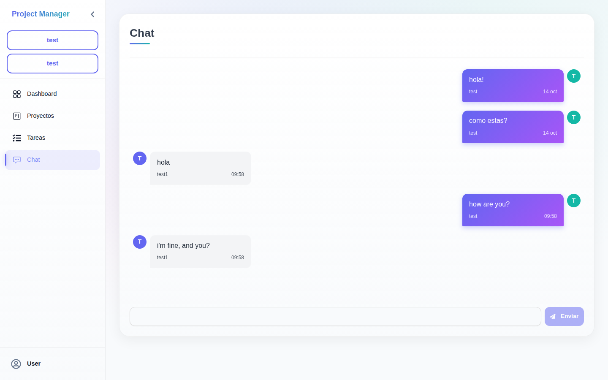

# Task Manager Frontend

Collaborative task-management dashboard (groups, projects, Kanban board, comments and real-time chat) built with **React + TypeScript** for the [FastAPI Task API](https://github.com/SrStamm/API-de-tareas-con-FastAPI).

[English](README.md) | [Español](README.es.md)

**Live demo:** <https://front-task-api-vanilla.vercel.app/dashboard/tasks>

## Description & main functionalities

This frontend is the web client for the Task API. It is designed for **collaborative work**, organizing users, projects and tasks with real-time communication on top:

- **Groups** — create groups, manage members and assign group roles.
- **Projects** — projects inside groups, with their own members and permissions.
- **Kanban tasks** — drag & drop board (`@dnd-kit`) with states, labels and a detail modal.
- **Task comments** — threaded comments inside each task's detail view.
- **Assigned-tasks view** — personal paginated list of tasks assigned to the current user.
- **Real-time chat** — per-project messaging over WebSocket.
- **Instant notifications** — pushed over the same WebSocket connection.
- **Roles & permissions** — actions restricted by group role and project permission.
- **Dark / light theme** — toggle persisted in `localStorage`.
- **Task filters** — filter project and assigned tasks by state and label.

## Architecture diagram

The app is a Vite + React SPA organized in feature folders. The data layer uses TanStack Query on top of a shared `Fetch` wrapper (`src/utils/api.ts`) that injects the JWT from `localStorage`; realtime flows through a dedicated WebSocket hook.



Key pieces of the real codebase:

| Layer | Location | Role |
| ----- | -------- | ---- |
| Routing & guards | `src/routes/AppRouter.tsx`, `ProtectedRoute`, `PublicRoute` | Public `/login` & `/register`; private `/dashboard/*` behind a token loader |
| Providers | `src/providers/AuthProvider.tsx`, `GroupProjectProvider.tsx` | Auth state (user, login/logout) and selected group/project + role/permission context |
| REST client | `src/utils/api.ts` | Single `Fetch` wrapper: JSON body, `Bearer` token, error handling |
| Query layer | `src/features/*` hooks | TanStack Query caches, mutations and infinite pagination for assigned tasks |
| Realtime | `src/features/chat/hooks/useChatSocket.ts` | One socket, fan-out to subscribed listeners (chat, project updates) |
| Feature folders | `src/features/{groups,projects,tasks,comments,chat,users}` | Each feature owns its `api/`, `components/`, `hooks/` and `schemas/` (Zod) |

## Technologies

| Technology | Version | Role |
| ---------- | ------- | ---- |
| React | ^18.2.0 | UI library |
| TypeScript | ~5.9.3 | Type system |
| Vite | ^7.1.7 | Dev server and production bundler |
| react-router-dom | ^7.9.5 | Client-side routing (data router + loaders) |
| TanStack Query | ^5.90.12 | Server-state layer (queries, mutations, cache) |
| @dnd-kit (core + modifiers) | ^6.3.1 / ^9.0.0 | Kanban drag & drop |
| Zod | ^4.1.12 | Schema validation |
| react-icons | ^5.5.0 | Icon set |
| ESLint | ^9.36.0 | Linting (flat config, `typescript-eslint`) |
| CSS | — | Plain custom CSS, light/dark themes |
| Backend | — | [FastAPI Task API](https://github.com/SrStamm/API-de-tareas-con-FastAPI) (REST + WebSocket + JWT) |

## Installation & execution

> The app lives in the `front-tasks/` directory. The tracked lockfile is `package-lock.json`, so **npm is the canonical package manager**.

1. Clone the repository:

   ```bash
   git clone https://github.com/SrStamm/front-task-api-vanilla.git
   cd front-task-api-vanilla/front-tasks
   ```

2. Install dependencies:

   ```bash
   npm install
   ```

3. Configure the environment variables (see next section).

4. Start the development server:

   ```bash
   npm run dev
   ```

5. Open the browser at <http://localhost:5173>.

<details>
<summary>Optional: pnpm</summary>

```bash
pnpm install
pnpm dev
```

</details>

## Environment variables

Create a `.env` file inside `front-tasks/` (Vite reads `VITE_*` variables at build/dev time):

| Variable | Purpose | Example |
| -------- | ------- | ------- |
| `VITE_URL` | Base URL of the REST API | `https://your-api.example.com` |
| `VITE_URL_WS` | Base URL of the WebSocket endpoint | `wss://your-api.example.com` |

```bash
# front-tasks/.env
VITE_URL=https://your-api.example.com
VITE_URL_WS=wss://your-api.example.com
```

Both URLs must point at a running instance of the [FastAPI Task API](https://github.com/SrStamm/API-de-tareas-con-FastAPI).

## Tests & commands

| Script | Command | Purpose |
| ------ | ------- | ------- |
| `npm run dev` | `vite` | Development server with HMR |
| `npm run build` | `tsc -b && vite build` | Type-check and produce the production bundle in `dist/` |
| `npm run lint` | `eslint .` | Lint all TypeScript/TSX files (flat config) |
| `npm run preview` | `vite preview` | Serve the production build locally |

> **Honest note:** there is currently **no unit-test suite** configured in this project. The available verification commands are `npm run lint` and `npm run build`.

## Screenshots

| Screenshot | Preview |
| ---------- | ------- |
| Login |  |
| Dashboard |  |
| Tasks — Kanban board |  |
| Chat |  |

## Known limitations

Current pending fixes, in order of impact:

1. **Occasional duplicate messages** in the chat and project views — TanStack Query observers need tuning so realtime updates do not re-render duplicated entries.
2. **WebSocket reconnection** — the socket hook has no automatic reconnect/backoff strategy yet; a dropped connection requires a page refresh.
3. **Redundant `/refresh` calls** — some flows trigger the refresh endpoint more than necessary and should be deduplicated.
4. **No automated test suite** — verification currently relies on `npm run lint` and `npm run build`.

## Live demo

- **URL:** <https://front-task-api-vanilla.vercel.app/dashboard/tasks>
- **Username:** `test`
- **Password:** `123456`

## Author

**Mirko Alexander Stamm** — Backend & Full-Stack developer.

## License

This project is distributed under the MIT license.
